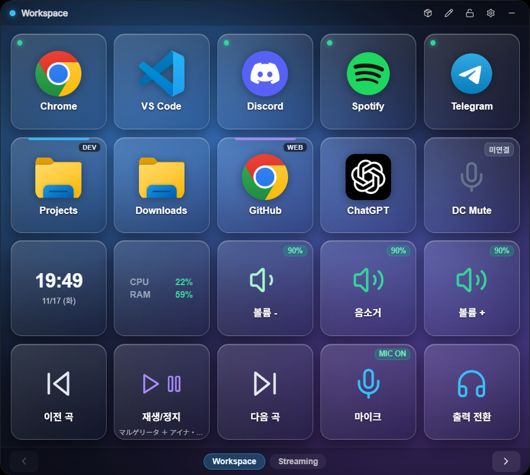

# TouchDeck

Windows 터치모니터 및 데스크톱 환경을 위한 **초경량 Stream Deck 대안 런처**입니다.  
웹서버, SQLite DB, 별도 에이전트 없이 **단일 네이티브 앱(Tauri v2 + Rust)** 으로 동작하며, 시스템 트레이에서 조용히 관리됩니다.



---

## 주요 기능

- **드래그 앤 드롭 원클릭 등록 & URL 파비콘**
  - 바탕화면 바로가기(`.lnk`), 실행 파일(`.exe`, `.cmd`, `.bat`, `.vbs`), 폴더, `.url` 파일을 빈 칸에 끌어다 놓으면 원본 경로·인자·작업 디렉토리를 자동 해석합니다.
  - Windows `IShellLinkW` + `SHIL_JUMBO` API로 **256×256 고해상도 아이콘**을 추출해 PNG로 저장합니다.
  - 웹 URL 버튼은 사이트의 고해상도 **파비콘(favicon)** 을 자동으로 가져와 적용할 수 있습니다.
  - 기존 버튼 위에 이미지 파일(`.png`, `.jpg`, `.webp`, `.ico`)을 드롭하면 아이콘이 즉시 교체됩니다.
- **포커스 유지 (`WS_EX_NOACTIVATE`) & 실행 중인 창 제어**
  - 평상시 버튼을 터치해도 메인 작업 창(게임·에디터·브라우저)의 포커스를 뺏지 않고 명령을 실행합니다.
  - 이미 실행 중인 앱은 버튼 좌상단에 **실행 중 상태 점**이 표시되며, 최소화(`SW_RESTORE`) 해제 후 맨 앞으로 올립니다(선택 시 재터치 최소화 토글 지원).
  - 탐색기 폴더는 `IShellWindows`로 이미 열린 동일 경로 창을 찾아 중복 실행 없이 활성화합니다.
  - 버전 폴더(`app-*`) 구조의 앱 업데이트 시 최신 버전 폴더를 자동 탐색합니다.
- **Stream Deck 기본 제어 & 위젯 타일**
  - **버튼 보관함 & 기본 프리셋 서랍**: 기본 미디어·볼륨·Discord·위젯 버튼을 필요할 때만 서랍에서 드래그해 꺼내 쓰고, 당장 안 쓰는 버튼은 보관함에 넣어둘 수 있습니다.
  - **Discord 양방향 RPC 연동**: 로컬 파이프(`discord-ipc-0`) + OAuth2 승인으로 마이크 음소거·데픈 상태를 실시간 동기화하고 제어합니다.
  - **볼륨 / 마이크 음소거**: 스피커 볼륨 조절·음소거(`%` / `MUTE` 배지), 마이크 음소거 토글(`MIC ON` / `MIC OFF`)
  - **오디오 출력 장치 전환**: 스피커 ↔ 헤드셋 등 활성 출력 장치를 원터치 순환/지정 전환
  - **미디어 제어 & 재생 정보(SMTC)**: 재생/일시정지, 다음/이전 곡, 정지 및 현재 재생 중인 곡 제목 표시
  - **단축키 녹화 & 멀티 액션**: 키 조합 녹화 입력기 및 딜레이를 포함한 다단계 순차 실행
  - **정보 타일**: 실시간 시계, **맞춤형 하드웨어 모니터(CPU 사용률/클럭/온도, RAM, GPU 사용률/온도/클럭/VRAM)**, 현재 재생 중인 곡 위젯
  - **멀티 페이지**: 좌우 터치/마우스 스와이프, 페이지 버튼, 페이지 간 버튼 복제/이동
- **디자인 & 레이아웃 커스터마이징**
  - 가로/세로 칸 수(`2×1` ~ `10×8`), 칸 크기(`76px` ~ `180px`), 간격, 모서리 둥글기, 칸 크기 비례 폰트 및 둥근 아이콘 마스킹
  - 패널 전체 배경: **단색 + 투명도 / 그라데이션 / 커스텀 배경 이미지(블러·어둡기 조절)**
  - 버튼 스타일 3종(**솔리드 / 반투명 글래스 / 투명 + 그림자**), 코너 배지 및 상단 포인트 컬러
  - **편집 모드**: 마우스 및 터치 드래그로 버튼 자리 이동·교환
- **트레이 관리, 자동 업데이트 & 창 안정성**
  - **GitHub 자동 업데이트**: 시작 시 `ForUltraplayer/TouchDeck` 최신 릴리즈를 자동 추적하며, 새 버전 감지 시 설정에서 원클릭 다운로드·교체·재시작을 지원합니다.
  - 작업표시줄에 표시되지 않고(`skipTaskbar`) 시스템 트레이 아이콘(보이기/숨기기/설정/종료)으로 관리합니다.
  - 멀티모니터 환경 변경 시 화면 밖 좌표를 자동 보정하며, `Win+D`(바탕화면 보기) 방어 옵션을 제공합니다.
  - 실행 파일 옆에 `data/` 폴더(또는 `portable.flag`)를 두면 포터블 모드로 동작해 폴더째 다른 PC로 복사하면 동일 설정·아이콘이 그대로 유지됩니다.
  - Windows 시작 프로그램 자동 실행 등록/해제 지원.

---

## 기술 스택

| 영역 | 기술 |
|---|---|
| 데스크톱 런타임 | [Tauri v2](https://v2.tauri.app/) (Windows WebView2) |
| 백엔드 / Win32 | Rust (`windows` crate, `image`, `serde`) |
| 프론트엔드 | React 19, TypeScript, Vite, `lucide-react` |

---

## 빌드 및 실행 방법 (Windows)

### 사전 요구사항
- Node.js 18+
- Rust (`rustup`)
- Visual Studio Build Tools (C++를 사용한 데스크톱 개발)
- Microsoft Edge WebView2 Runtime (Windows 10/11 기본 내장)

### 개발 실행
```bash
npm install
npm run tauri dev
```

### 단일 실행 파일 빌드 (포터블)
```bash
npm run tauri build -- --no-bundle
```
빌드 완료 후 `src-tauri/target/release/touchdeck.exe`를 원하는 폴더에 두고 실행할 수 있습니다.  
같은 폴더에 `data/` 디렉토리를 만들거나 설정에서 **"포터블 모드 전환"**을 누르면 설정(`config.json`)과 아이콘(`assets/`)이 로컬에 저장됩니다.

---

## 폴더 구조

```text
TouchDeck/
├── src/                        # React + TypeScript UI
│   ├── App.tsx                 # 패널, 드래그 앤 드롭, 페이지 전환, 창 크기 동기화
│   └── components/
│       ├── ButtonTile.tsx      # 타일 렌더링 및 터치/포인터 드래그
│       ├── ButtonEditorModal.tsx
│       └── SettingsDrawer.tsx
└── src-tauri/src/              # Rust Win32 네이티브 백엔드
    ├── config.rs               # 설정 저장/로드 및 포터블 경로 관리
    ├── win_shell.rs            # .lnk/.url 해석 및 256px Jumbo 아이콘 추출
    ├── win_focus.rs            # 창 복원 및 포그라운드 활성화, 탐색기 중복 방지
    ├── win_media.rs            # Core Audio 볼륨 제어, 미디어 키, 단축키
    ├── win_window.rs           # 시작 프로그램 바로가기 관리
    └── lib.rs                  # Tauri 커맨드 및 시스템 트레이
```
